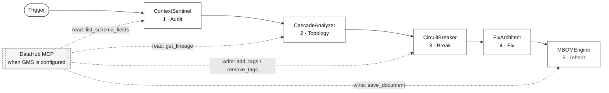

# MidSphere

<p align="center">
  
</p>

<p align="center">
  <strong>Autonomous Context Circuit-Breaker Engine for Data Platforms</strong><br />
  <em>DataHub · MCP · Google Antigravity SDK · Gemini</em>
</p>

<p align="center">
  <a href="https://github.com/adi-IL/MidSphere/actions/workflows/ci.yml"></a>
  <a href="https://github.com/adi-IL/MidSphere/actions/workflows/deploy-frontend.yml"></a>
  <a href="https://github.com/adi-IL/MidSphere/actions/workflows/deploy-backend.yml"></a>
  <a href="./LICENSE"></a>
  <a href="https://github.com/datahub-project/datahub-skills/pull/88"></a>
</p>

<!-- Judge demo: record a 60 second GIF of Run -> Trip -> Lift in the Command Center,
     save it as frontend/public/demo.gif, then uncomment this block.
<p align="center">
  
</p>
-->

> **Organizations deploy AI agents faster than they can keep catalog context trustworthy.**
>
> Schema drift, quality defects, ungoverned PII, and missing ownership do not stop at an alert.
> **Agents that continue to read the catalog inherit the damage.**

Many catalogs only record that something failed. **MidSphere treats that as insufficient.** It runs a closed loop that **audits context**, scores **selective blast radius**, applies **advisory** quarantine, produces a **dry-run fix artifact**, and leaves an **MBOM** attestation path so the next human or agent can inherit safer knowledge.

When DataHub mutations are enabled and GMS is reachable, quarantine is written as **graph state** (tags, structured properties, documents). Otherwise it remains **job-local** with `mutations_applied=false`. MidSphere **Consumer Gate** returns `BLOCKED` for MidSphere-aware clients. This repository does **not** claim that every third-party MCP consumer is automatically denied by the platform.

Built for [Build with DataHub: The Agent Hackathon](https://datahub.devpost.com/).

## Why not a scanner or a gateway

MCP security scanners and gateways inspect tool metadata and block at the proxy. MidSphere starts where those stop.

| Capability | Scanners and gateways | MidSphere |
| --- | --- | --- |
| Detection surface | Tool metadata and tool calls | Catalog context: quality, PII, freshness, ownership |
| Action on finding | Alert or proxy deny | Advisory quarantine written to DataHub graph state (tags, structured properties, documents) |
| Reversibility | Reconfigure the proxy | Lift via `remove_tags` through the official MCP server |
| Consumer enforcement | At the gateway | Consumer Gate returns `BLOCKED` for MidSphere-aware clients only (no platform-wide claim) |
| Evidence | Scan report | MBOM attestation and dry-run fix artifact |

## Live surfaces

| Surface | URL |
| --- | --- |
| Command Center | https://midsphere.vercel.app |
| API (Cloud Run) | https://midsphere-api-1053689941073.us-central1.run.app |
| Source | https://github.com/adi-IL/MidSphere |

### Status honesty (Command Center)

The UI is minimal monochrome (no emoji). Status labels are defined as follows.

| UI label | Meaning |
| --- | --- |
| **API · Job** | API is up **and** the canvas job came from the API (latest, Run, or Trip) |
| **API · Sample** | API is up but the canvas is a local demo fixture (e.g. scenario tab without Run) |
| **Offline** | API unreachable; sample fixtures from `frontend/src/lib/demoJob.ts` |
| **GMS** / **GMS off** | API GMS probe (`datahub_reachable`) |
| Pipeline **Sample** / **Agent** / **Live MCP** | Run kind derived from `execution_mode` and job source |
| **Run** completes | Closed loop finished (Google Antigravity primary and/or deterministic fallback) |
| Decision **Fix** / **Attestation** | Scenario paths under [`examples/`](examples/) (dry-run) |
| Live tags / `save_document` / Lift `remove_tags` | GMS reachable and `TOOLS_IS_MUTATION_ENABLED=true` (see job `mutations_applied` and TOOL events) |

**Operator path:** open the live app, select **Hospital**, **Retail**, or **Taxi**, click **Run**, inspect the selective graph (impacted vs open fork), use Decision **Findings / Gate / Attestation**, then **Trip / Lift**. Expand **Telemetry** for stage logs. When mutations are live, look for `add_tags official_mcp ok` after trip/Run and `remove_tags official_mcp ok` after Lift (also in the Network response body).

**Manual smoke checklist:** [docs/MANUAL_TEST.md](./docs/MANUAL_TEST.md).

## Closed loop

| Stage | Component | Shipping behavior |
| --- | --- | --- |
| 1. Audit | `ContextSentinel` | Scenario findings (quality, PII, freshness) |
| 2. Topology | `CascadeAnalyzer` | Selective blast radius and risk score |
| 3. Break | `CircuitBreaker` | Advisory quarantine; live tags only if GMS and mutations are enabled |
| 4. Fix | `FixArchitect` | Dry-run SQL/dbt path under `examples/prs/` |
| 5. Inherit | `MBOMEngine` | MBOM path under `examples/mboms/`; live `save_document` only if mutations are enabled |



**Primary workforce:** [Google Antigravity SDK](https://github.com/google-antigravity/antigravity-sdk-python) for Python (`pip install google-antigravity`; `Agent` + `LocalAgentConfig` with custom MidSphere stage tools on Vertex Gemini). Official DataHub MCP attaches when GMS is reachable. Stage tools may call `get_lineage`, `list_schema_fields`, `add_tags`, and `save_document` when mutations are enabled. On Agent failure, a deterministic fallback completes the job with simulated telemetry labels when offline.

### Scenario packs

Packs are defined in `backend/agents/scenarios.py` and mirrored in Command Center fixtures.

| Scenario | Root dataset | Risk | Quarantine target | Open fork |
| --- | --- | --- | --- | --- |
| Hospital (healthcare) | `healthcare.raw_patients` | 61 | `mart_billing` | `mart_demographics` |
| Retail (ecommerce PII) | `ecommerce.raw_customers` | 88 | `mart_customer_360` | `mart_product_catalog` |
| Taxi (NYC freshness) | `nyctaxi.raw_yellow_trips` | 65 | `mart_monthly_revenue` | `mart_trip_distance_stats` |

**Timeline** (graph control, off by default) is a closed-loop narrative scrubber. It is not a live GMS history browser.

## Stack

| Layer | Technology |
| --- | --- |
| Frontend | React 18, Vite, TypeScript, Tailwind, React Flow, Geist |
| Backend | FastAPI, Pydantic, httpx, uvicorn |
| Primary workforce | [Google Antigravity SDK](https://github.com/google-antigravity/antigravity-sdk-python) (Python package `google-antigravity`) + `backend/agents/stage_tools.py` |
| Fallback | Deterministic stages in `backend/agents/pipeline.py` |
| Models | Gemini via Vertex AI (ADC) |
| Catalog | DataHub GMS and official [mcp-server-datahub](https://github.com/acryldata/mcp-server-datahub) via `uvx` |
| Deploy | Vercel project `midsphere`, GCP Cloud Run `midsphere-api` |

## MCP tools (real names only)

**Read:** `search`, `get_entities`, `list_schema_fields`, `get_lineage`, `get_lineage_paths_between`, `get_dataset_queries`

**Write** (requires `TOOLS_IS_MUTATION_ENABLED=true` on the MCP server): `add_tags`, `remove_tags`, `add_structured_properties`, `save_document`

No invented `datahub_*` tool prefixes. No MCP `create_incident`.

## Quick start

```bash
git clone https://github.com/adi-IL/MidSphere.git
cd MidSphere
cp .env.example .env
# optional: DATAHUB_GMS_URL / DATAHUB_GMS_TOKEN
# Vertex: GOOGLE_CLOUD_PROJECT and ADC

cd backend
python3 -m venv .venv && source .venv/bin/activate
pip install -r requirements.txt
export ANTIGRAVITY_ENABLED=true
export USE_OFFICIAL_MCP=true
PYTHONPATH=. uvicorn app.main:app --reload --port 8000

# second terminal
cd frontend && npm install && npm run dev
```

Cloud Run cannot use laptop `localhost` as GMS. Operators run official DataHub quickstart on GCE and set `DATAHUB_GMS_URL` to the VM public IP (see [`scripts/README.md`](scripts/README.md)).

```bash
./scripts/gce_datahub_schedule.sh apply      # weekday start / nightly stop
./scripts/gce_datahub_schedule.sh stop-now
./scripts/gce_datahub_schedule.sh start-now  # starts VM, re-points Cloud Run, waits for GMS
```

## API

| Method | Path | Purpose |
| --- | --- | --- |
| GET | `/v1/health` | Health and stack metadata |
| POST | `/v1/jobs` | Run closed loop |
| GET | `/v1/jobs/latest` | Latest job (404 if none; does not auto-run) |
| GET | `/v1/jobs/{id}` | Job by id |
| POST | `/v1/jobs/{id}/lift` | Lift quarantine |
| POST | `/v1/jobs/{id}/trip` | Re-run closed loop with auto-trip |
| GET | `/v1/gate/{urn}` | Consumer Gate decision |
| GET | `/v1/gate-default-blocked` | Convenience gate for healthcare `mart_billing` only (not “latest job blocked entity”) |

## Sample Datasets

To ensure MidSphere's agents operate on realistic, complex lineage graphs, we developed three custom data environments for this project (Healthcare, Retail, NYC Taxi).

To keep this application repository lean and focused on the agentic engine, the raw mock data, schemas, and DataHub ingestion recipes are hosted upstream:
**[datahub-project/static-assets/tree/main/datasets](https://github.com/datahub-project/static-assets/tree/main/datasets)**

If you are running the GCE VM Quickstart, you can use `scripts/load_healthcare.sh` in conjunction with these datasets to populate your live DataHub instance.

## Open-source contribution

Upstream skills PR (open):  
[datahub-project/datahub-skills#88](https://github.com/datahub-project/datahub-skills/pull/88) (`datahub-circuit-breaker`, `datahub-quality-circuit`).

Local mirrors: [`skills/`](skills/).

## Repository layout

Public OSS tree aligned with common monorepo practice and the hackathon submission requirements (public source, Apache 2.0, setup instructions, optional sample artifacts):

```
.
├── LICENSE             Apache 2.0 (required; visible at repo root)
├── README.md           Overview, honesty table, quick start
├── ARCHITECTURE.md     Shipping contracts (short)
├── .env.example        Env template (no secrets)
├── .gitignore
├── .github/            CI + deploy workflows
│   ├── DEPLOY.md
│   └── workflows/
├── backend/            Closed-loop API (Cloud Run)
│   ├── app/ api/ agents/ gate/ midsphere_mcp/ models/ tests/
│   ├── requirements.txt
│   └── Dockerfile
├── frontend/           Command Center (Vercel)
│   ├── src/ public/
│   └── package.json
├── examples/           Judge-readable sample outputs (optional but present)
│   └── mboms/ prs/ jobs/ telemetry/
├── skills/             Upstream skill mirrors (datahub-skills PR #88)
├── scripts/            Operator helpers (GCE GMS schedule, bootstrap)
└── docs/               Index + MANUAL_TEST.md (judge smoke)
```

| Path | Role for judges |
| --- | --- |
| Live Command Center | End-to-end UI |
| `examples/` | Offline MBOMs, dry-run diffs, telemetry without running the stack |
| `backend/` + `frontend/` | Full source to run locally |
| `LICENSE` | Apache 2.0 |

Local-only material (not part of the public product surface) is gitignored: `resource/`, `internal/`, large recon dumps.

## Documentation

1. [ARCHITECTURE.md](./ARCHITECTURE.md): shipping system contracts  
2. [docs/MANUAL_TEST.md](./docs/MANUAL_TEST.md): judge / operator manual smoke  
3. [examples/README.md](./examples/README.md): scenario artifacts  
4. [backend/README.md](./backend/README.md), [frontend/README.md](./frontend/README.md)  
5. [`.github/DEPLOY.md`](./.github/DEPLOY.md): deploy isolation  

## License

Apache License 2.0. See [LICENSE](./LICENSE).