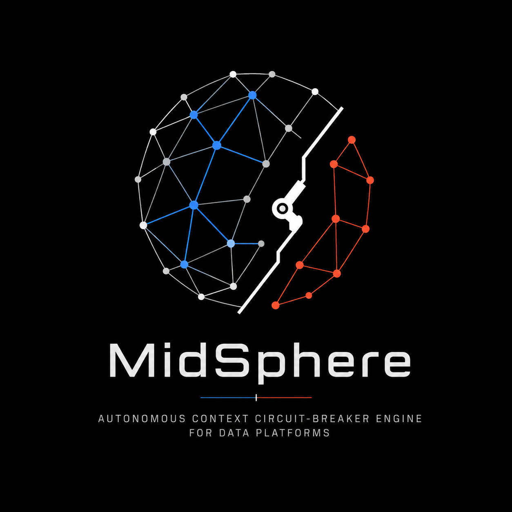

# MidSphere

<p align="center">
  
</p>

<p align="center">
  <strong>Autonomous Context Circuit-Breaker Engine for Data Platforms</strong><br />
  <em>DataHub · MCP · Antigravity · Gemini</em>
</p>

Organizations deploy AI agents faster than they can keep catalog context trustworthy. Schema drift, quality defects, ungoverned PII, and missing ownership do not stop at an alert. Agents that continue to read the catalog inherit the damage.

Many catalogs only record that something failed. MidSphere treats that as insufficient. It runs a closed loop that audits context, scores selective blast radius, applies **advisory** quarantine, produces a dry-run fix artifact, and leaves an **MBOM** attestation path so the next human or agent can inherit safer knowledge.

When DataHub mutations are enabled and GMS is reachable, quarantine is written as graph state (tags, structured properties, documents). Otherwise it remains **job-local** with `mutations_applied=false`. MidSphere **Consumer Gate** returns `BLOCKED` for MidSphere-aware clients. This repository does **not** claim that every third-party MCP consumer is automatically denied by the platform.

Built for [Build with DataHub: The Agent Hackathon](https://datahub.devpost.com/).

## Live surfaces

| Surface | URL |
| --- | --- |
| Command Center | https://midsphere.vercel.app |
| API (Cloud Run) | https://midsphere-api-1053689941073.us-central1.run.app |
| Source | https://github.com/adi-IL/MidSphere-datahb |

### Status honesty (Command Center)

The UI is minimal monochrome (no emoji). Status labels are defined as follows.

| UI label | Meaning |
| --- | --- |
| **Live** | Frontend reached Cloud Run (`GET /v1/health` returns ok) |
| **GMS** / **GMS off** | API GMS probe (`datahub_reachable`) |
| **Offline** | API unreachable; sample fixtures from `frontend/src/lib/demoJob.ts` |
| Pipeline **Sample** / **Agent** / **Live MCP** | Run kind derived from `execution_mode` and job source |
| **Run** completes | Closed loop finished (Antigravity primary and/or deterministic fallback) |
| Decision **Fix** / **Attestation** | Scenario paths under [`examples/`](examples/) (dry-run) |
| Live tags / `save_document` | GMS reachable and `TOOLS_IS_MUTATION_ENABLED=true` (see job `mutations_applied`) |

**Operator path:** open the live app, select **Hospital**, **Retail**, or **Taxi**, click **Run**, inspect the selective graph (impacted vs open fork), use Decision **Findings / Gate / Attestation**, then **Trip / Lift**. Expand **Telemetry** for stage logs. When mutations are live, look for `official_mcp ok` lines.

## Closed loop

| Stage | Component | Shipping behavior |
| --- | --- | --- |
| 1. Audit | `ContextSentinel` | Scenario findings (quality, PII, freshness) |
| 2. Topology | `CascadeAnalyzer` | Selective blast radius and risk score |
| 3. Break | `CircuitBreaker` | Advisory quarantine; live tags only if GMS and mutations are enabled |
| 4. Fix | `FixArchitect` | Dry-run SQL/dbt path under `examples/prs/` |
| 5. Inherit | `MBOMEngine` | MBOM path under `examples/mboms/`; live `save_document` only if mutations are enabled |

```
Trigger -> Sentinel -> Cascade -> Breaker -> Fix -> MBOM
              |           |         |
              +---- DataHub MCP when GMS is configured (read; optional writes) ----+
```

**Primary workforce:** Google Antigravity Agent with five MidSphere stage tools on Vertex Gemini (required dependency). Official DataHub MCP attaches when GMS is reachable. Stage tools may call `get_lineage`, `list_schema_fields`, `add_tags`, and `save_document` when mutations are enabled. On Agent failure, a deterministic fallback completes the job with simulated telemetry labels when offline.

### Scenario packs

Packs are defined in `backend/agents/scenarios.py` and mirrored in Command Center fixtures.

| Scenario | Risk | Quarantine target | Open fork |
| --- | --- | --- | --- |
| Hospital (healthcare) | 61 | `mart_billing` | `mart_demographics` |
| Retail (ecommerce PII) | 88 | `mart_customer_360` | `mart_product_catalog` |
| Taxi (NYC freshness) | 65 | `mart_monthly_revenue` | `mart_trip_distance_stats` |

**Timeline** (graph control, off by default) is a closed-loop narrative scrubber. It is not a live GMS history browser.

## Stack

| Layer | Technology |
| --- | --- |
| Frontend | React 18, Vite, TypeScript, Tailwind, React Flow, Geist |
| Backend | FastAPI, Pydantic, httpx, uvicorn |
| Primary workforce | [Google Antigravity](https://github.com/google-antigravity/antigravity-sdk-python) and `backend/agents/stage_tools.py` |
| Fallback | Deterministic stages in `backend/agents/pipeline.py` |
| Models | Gemini via Vertex and ADC |
| Catalog | DataHub GMS and official [mcp-server-datahub](https://github.com/acryldata/mcp-server-datahub) via `uvx` |
| Deploy | Vercel project `midsphere`, GCP Cloud Run `midsphere-api` |

## MCP tools (real names only)

**Read:** `search`, `get_entities`, `list_schema_fields`, `get_lineage`, `get_lineage_paths_between`, `get_dataset_queries`

**Write** (requires `TOOLS_IS_MUTATION_ENABLED=true` on the MCP server): `add_tags`, `remove_tags`, `add_structured_properties`, `save_document`

No invented `datahub_*` tool prefixes. No MCP `create_incident`.

## Quick start

```bash
git clone https://github.com/adi-IL/MidSphere-datahb.git
cd MidSphere-datahb
cp .env.example .env
# optional: DATAHUB_GMS_URL / DATAHUB_GMS_TOKEN
# Vertex: GOOGLE_CLOUD_PROJECT and ADC

cd backend
python3 -m venv .venv && source .venv/bin/activate
pip install -r requirements.txt
export ANTIGRAVITY_ENABLED=true
export USE_OFFICIAL_MCP=true
PYTHONPATH=. uvicorn app.main:app --reload --port 8000

# second terminal
cd frontend && npm install && npm run dev
```

Cloud Run cannot use laptop `localhost` as GMS. Operators run official DataHub quickstart on GCE and set `DATAHUB_GMS_URL` to the VM public IP (see [`scripts/README.md`](scripts/README.md)).

```bash
./scripts/gce_datahub_schedule.sh apply      # weekday start / nightly stop
./scripts/gce_datahub_schedule.sh stop-now
./scripts/gce_datahub_schedule.sh start-now  # starts VM, re-points Cloud Run, waits for GMS
```

## API

| Method | Path | Purpose |
| --- | --- | --- |
| GET | `/v1/health` | Health and stack metadata |
| POST | `/v1/jobs` | Run closed loop |
| GET | `/v1/jobs/latest` | Latest job |
| GET | `/v1/jobs/{id}` | Job by id |
| POST | `/v1/jobs/{id}/lift` | Lift quarantine |
| POST | `/v1/jobs/{id}/trip` | Re-run closed loop with auto-trip |
| GET | `/v1/gate/{urn}` | Consumer Gate decision |
| GET | `/v1/gate-default-blocked` | Convenience gate for healthcare billing URN |

## Open-source contribution

Upstream skills PR (open):  
[datahub-project/datahub-skills#88](https://github.com/datahub-project/datahub-skills/pull/88) (`datahub-circuit-breaker`, `datahub-quality-circuit`).

Local mirrors: [`skills/`](skills/).

## Repository layout

```
frontend/          Command Center (Vercel)
backend/           Closed-loop API (Cloud Run)
examples/          Scenario MBOMs, dry-run diffs, job fixture, sample telemetry
skills/            Upstream skill mirrors (PR #88)
scripts/           Bootstrap and GCE schedule helpers
ARCHITECTURE.md    Shipping architecture
.github/           Path-filtered CI and deploy
```

## Documentation

1. [ARCHITECTURE.md](./ARCHITECTURE.md): shipping system contracts  
2. [examples/README.md](./examples/README.md): scenario artifacts  
3. [backend/README.md](./backend/README.md), [frontend/README.md](./frontend/README.md)  
4. [`.github/DEPLOY.md`](./.github/DEPLOY.md): deploy isolation  

## License

Apache License 2.0. See [LICENSE](./LICENSE).
